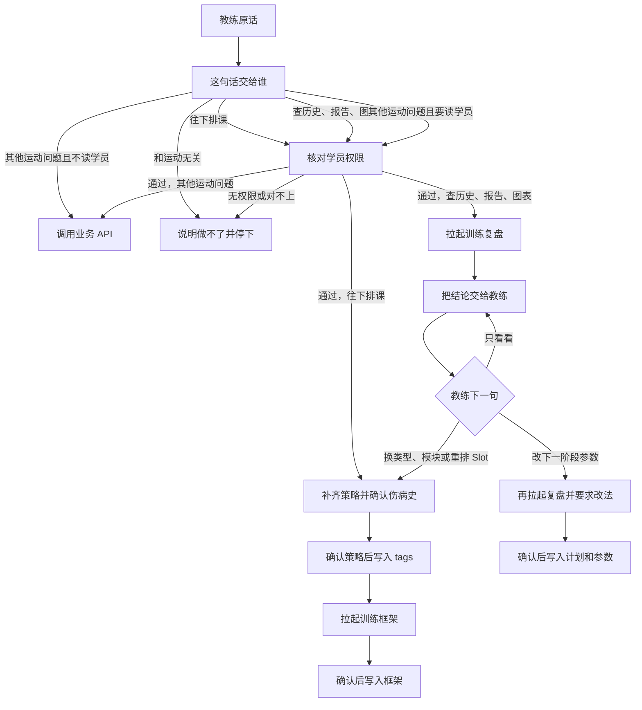

# Agent 1.0

1.0 做三件事：训练框架、训练复盘，以及一版能用的记忆。需求归类仍由教练面对的对话完成。对话按教练这句话决定拉起哪一个：要往下排课，拉起训练框架；要查历史、写报告或出图，拉起训练复盘。课前分发留到后面。

对话由教练或有管理权限的人发起时，先问学员名称。agent 核对当前使用者对该学员的权限。名称对不上或没有权限，不往下进行。子 agent 只接收已经核对过的学员。

## 这一版交出什么

教练说清需求、确认伤病史并确认训练策略之后，对话拉起训练框架 agent。它交回一份框架：先是 Slot 编排，再是每个 Slot 上的动作和参数。框架回到对话里给教练看。教练确认之后才落库。没确认，不写入。策略或伤病史还没确认、权限没核对、或评估不在库时，不拉起这个 agent。

教练要看已经发生的训练时，对话拉起训练复盘 agent。它查询这名学员的历史数据，交回负荷、容量、完成情况；任务要报告或图表时一并交回。课刚结束，或对话里问上次、这一段练得怎么样，都走它。任务里写了要改下一阶段时，再附上计划和参数的改法；改法回到对话里，教练确认之后由主 agent 写入。只要求总结时，不提改法。

## 主 agent

教练面对的是主 agent。它听原话，先判断这句话该拉起哪一个子 agent。和运动相关、但用不着子 agent 的，主 agent 直接调用业务 API，把返回结果交给教练。子 agent 看不到原话，只拿这次任务说明，彼此也不互相调用。一次只拉起一个。

### 权限

使用者是教练，或有管理权限、正在代学员操作的人。主 agent 先按学员名称确定是谁，再核对该使用者有没有这名学员的权限。队伍里的每人单独核对。没有权限时，不读这名学员的档案，不拉起子 agent，也不说明库里有什么。

主 agent 自己的读写：

- 读：当前使用者的身份和权限、学员名称对应的学员、该学员 `user.tags` 里待确认的伤病史、评估记录在不在库
- 调 API：运动相关、且不拉起子 agent 的请求，调用对应的业务 API，用返回结果回答
- 写：只写教练确认过的三样。确认策略之后，按键合并 `user.tags`。确认框架之后，写入训练框架。确认改法之后，写入计划和参数

排 Slot、写报告、出图、沙盒计算在子 agent 里。主 agent 不拿这些工具自己做，不写未确认的草案，不写别的学员，也不宣布某个动作可以做。要读某名学员的数据，无论走子 agent 还是 API，都先通过权限核对。

### 整体链路

复盘交回的结论可以由主 agent 收成一段摘要，放进下一次任务说明。框架不读复盘的中间过程。沙盒只在复盘里面打开，主 agent 不直接调用。一般运动问题只走 API，不把结果写成框架或改法。

### 主循环

1. 这句话要读某名学员的数据时，先问清学员名称并核对权限。对不上或没有权限，停在这一步。不涉及具体学员的一般问题，不必先绑学员。
2. 判断交给谁。往下排课走训练框架，查历史、写报告或出图走训练复盘。说不清是排课还是复盘，问一句，不替教练选定。
3. 和运动相关，但不是上面两件的，直接调用对应的业务 API，把返回结果交给教练。不拉起子 agent，也不写入框架、tags 和计划改法。和运动无关的，说明做不了，不调 API。
4. 写成任务说明再拉起。框架要等策略和伤病史已经确认，且评估在库。复盘写明时间范围、要不要报告、要不要图表、要不要改法。教练只说看看，任务说明里不写改法。
5. 子 agent 交回后给教练看。框架、报告、图表和改法都先停在对话里。
6. 教练确认框架，写入框架。确认改法，写入计划和参数。确认策略时，档案键合并进 `user.tags`。没点头，或接着改口，改任务说明再拉起一次。

### 一般意图

和运动相关、又不需要训练框架或训练复盘时，主 agent 直接调用对应的业务 API。例如查一条已经在库里的业务数据，或问一个动作、一条训练规则。API 按这次问题返回。主 agent 把结果交给教练。

这次调用不拉起子 agent，不打开沙盒，也不写入 `user.tags`、训练框架、计划和参数。要读某名学员的数据，先核对权限；没有权限，不调那支 API。

该走子 agent 的不改走 API。要重排 Slot、更换训练类型或模块，走训练框架。要看已经练过的记录、写报告、出图或改下一阶段参数，走训练复盘。

### 接不住

和运动无关的请求，主 agent 说明做不了。不调 API，不拉起子 agent，不写库。

下面这些也不交给一般 API：

- 发这一次课，或补热身组、pre-set / after-set、进退阶和强度
- 教练还没确认，就要求把框架或改法写入
- 查看或修改没有权限的学员

## 训练框架 agent

它看不到教练的原话，只拿到这一次任务说明。

### 意图分析

开口归类在父对话里做完，收成一份策略。四类字段可以同时有值：训练类型、训练模块、人群、授课形态。类型和模块必须落在已有目录里，对不上就停下问。只选大类、后面全听安排时，模块由该类型的逻辑代选，代选结果写回策略一起确认。队伍共用类型、模块和周期，按人各生成一份框架。

必填：学员、训练类型或训练模块、频率、周期、水平、器械、已确认的伤病史。部位、动作模式、目标、项目有则写入。学员名称在对话里问到。权限没通过，不进入循环。

学员使用产品之前，教练已带其完成评估，结果在库中。任务说明带上这份评估。库里没有就停下，不补编能力数据。

伤病史在拉起之前单独确认。对话列出该学员 `user.tags` 里已有的关节问题和慢性病，给教练看。有则改完再点头，没有则确认「无」。队伍里每人问清名称、核对权限、确认伤病史，并带上各自已落库的评估。

策略确认之后，档案按键合并进该学员的 `user.tags`：`训练目标`、`训练目标备注`、`训练经验`、`关节问题`、`慢性病`、`慢性病备注`。训练经验只用：无训练史、`<6个月`、`6个月-2年`、`2-5年`、`>5年`。多个目标、多个关节各写一条。这次没提到的键和无前缀标签保留。频率、周期、部位、动作模式、这一次的模块、授课形态留在策略里。

### 循环

从这份已确认的任务说明开始：

1. 必填、伤病史确认、权限或评估缺了就停，把要问的交回对话。
2. 按策略从模板和周期计划里选出 Slot，排好顺序。
3. 从动作库补动作和参数。固定规则拒绝的动作不写入。
4. 补不满的 Slot 标出来交回，不编库外动作。
5. 框架交回对话。教练确认之后才落库。

循环里不改策略，不写 tags。

### 工具

- 核对当前使用者对该学员的权限
- 读已确认的策略
- 读该学员的 tags
- 读该学员已落库的评估
- 读动作库、计划模板库、周期计划库
- 读可做与禁忌的固定规则

不发这一次课，不写报告，也不算临时的数。

## 训练复盘 agent

它看不到教练的原话，只拿到这一次任务说明。主要做三件事：查询这名学员已经落库的历史数据，撰写报告，生成图表。课结束之后要一份结论，或对话里问上次、这一段练得怎么样，都走它。

### 意图分析

任务说明要有：看谁、哪一次或哪一段时间、要不要报告、要不要图表、要不要提出改法。看谁必须是已核对权限的学员。缺了就停，把要问的交回对话。

### 循环

1. 权限或时间范围缺了就停，把要问的交回对话。
2. 读已落库的历史数据。负荷、容量、完成情况用固定算法算。
3. 任务要报告时，写成给教练看的报告。要图表，或要一个还没有固定算法的数时，把这次读到的数据放进沙盒。
4. 任务里写了要改下一阶段时，再附计划和参数的改法。只要求总结时不提。
5. 报告、图表和改法交回主 agent。改法由主 agent 在教练确认之后写入。复盘自己不写库。

### 沙盒

复盘的工具，不是另一个子 agent。只接收这次已经读到的记录，没有数据库连接，也看不到别的学员。

负荷、容量、完成情况不进沙盒。一段对比、一条趋势，或一张还没有固定算法的图，放进沙盒算。数和图交回复盘，再随结论交给主 agent。沙盒不写计划和参数，也不宣布某个动作可以做。

### 工具

- 核对当前使用者对该学员的权限
- 读这个人已经落库的训练记录、评估、动作能力、力量储备，以及当前计划和参数。评估是使用产品前由教练带做、已经入库的那份
- 读这一次附上的记忆摘要
- 把本次读到的数据放进沙盒，取回数和图

不生成训练框架，不发这一次课。可做与禁忌仍由固定规则判定。写库在主 agent。

## 初步记忆

1.0 只记两层。系统层先不记：还没有「反复出现、再由人接受」这条流程。

| 层 | 留下什么 | 什么时候带上 |
| --- | --- | --- |
| 教练 | 这位教练确认过的写法、偏好，以及对 agent 的纠正 | 这位教练的每一轮 |
| 学员 | 表里没有的近况，例如这周膝不适、这一周期口头定的侧重 | 这一轮绑了该学员才带 |

目标、训练经验、关节问题、慢性病以 `user.tags` 为准。重量、训练记录、评估、已经落库的策略和课程以各自的业务表为准。这些都不写进记忆。

只在教练可见的一轮结束、并且这一轮已经有结论之后，才从教练的原话里抽取。两个子 agent 的中间过程不写记忆。说不清属于哪个学员的近况，不写入学员层。从 agent 自己的回复里反推出来的偏好不记。

下一轮不把两层全文塞进去。对话先带这位教练的习惯；绑了学员，再带该学员还没过期的近况。交给子 agent 的是这次任务说明里的一段摘要。记忆不能把一个被拒绝的动作说成可以做。

## 这一版不做什么

- 不拉起练前分发。
- 不把沙盒做成单独的子 agent。
- 不记系统层记忆，也不做候选的接受或拒绝。
